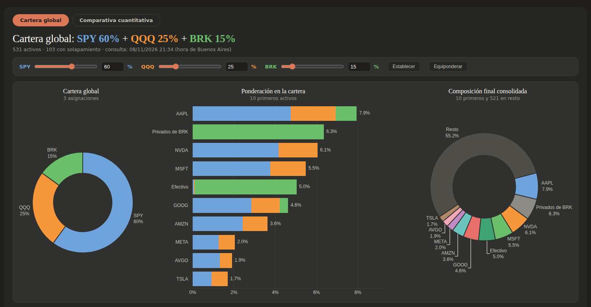

# Cartera global: SPY + QQQ + BRK

Tablero interactivo que calcula la **ponderación económica final** de una cartera repartida entre SPY, QQQ y Berkshire Hathaway, desarmando cada una en las empresas que contiene (sin doble conteo y con el efectivo y los negocios privados de BRK identificados).

**Ver el tablero actualizado:** https://maurosimeonoff.github.io/Finanzas/
&nbsp;·&nbsp; [Abrir en Colab](https://colab.research.google.com/github/maurosimeonoff/Finanzas/blob/main/Finanzas-GitHub.ipynb)

## Qué hace
- Lee las posiciones de SPY (State Street), QQQ (Invesco) y BRK (CNBC) y las consolida por empresa.
- Permite cambiar la asignación entre SPY, QQQ y BRK (pasos de 1%) y recalcula gráficos y tablas al instante.
- Informa la fecha de dato de cada fuente y verifica que la cartera cierre en 100%.

## Comparativa cuantitativa
Pestaña con SPY, QQQ, BRK, la Cartera global (rebalanceo trimestral sin fricciones) y un activo más a elección. Para sumar símbolos al selector, editar `activos.txt`: la página se regenera sola.

## Cómo se actualiza solo
GitHub Actions ejecuta `actualizar.py` todos los días a las 18:00 (hora de Buenos Aires) y publica `docs/index.html` en GitHub Pages.

## Puesta en marcha (una sola vez)
1. Subir a la raíz del repositorio: `Finanzas-GitHub.ipynb`, `actualizar.py`, `README.md` y `.github/workflows/actualizar.yml`.
2. Settings → Pages → *Deploy from a branch* → rama `main`, carpeta `/docs`.
3. Settings → Actions → General → *Workflow permissions* → **Read and write permissions**.
4. Pestaña Actions → *Actualizar cartera global* → **Run workflow** (primera ejecución manual).

## Archivos
| Archivo | Uso |
|---|---|
| `Finanzas-GitHub.ipynb` | Cuaderno de Colab con el programa completo |
| `actualizar.py` | Mismo programa, sin Colab, para la actualización diaria |
| `.github/workflows/actualizar.yml` | Programación diaria 18:00 |
| `activos.txt` | Símbolos extra para la comparativa |
| `docs/index.html` | Página publicada (se genera sola) |
